# project-presets

A [Herdr](https://herdr.dev) app mod: a project picker where each project is a local git checkout with its own settings. Press `ctrl-alt-p` (`cmd-alt-p`, ⌘⌥P, on macOS; `cmd-p` is already herdr's own space picker there), fuzzy-search, Enter. Per project you choose whether to open the checkout or a fresh worktree (always, ask for a branch name, or never), the branch-name template, whether to fetch first, which agent to start with which arguments and first prompt, setup commands and extra tabs.

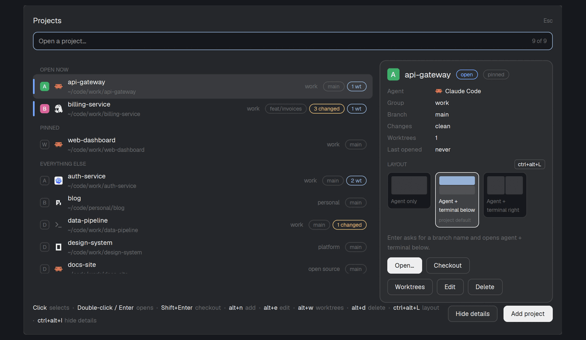

## Screens

Every view of the popup. The projects shown are demo data.

### Project list

Type to filter; the match is fuzzy and covers the name, the group and the folder name. Open spaces come first, then pinned projects (★), then recent ones. Each row ends with what Enter will do: `worktree` (always a new one), `worktree?` (asks for a branch name) or `checkout` (opens the folder itself). Scroll with the wheel or the arrow keys.

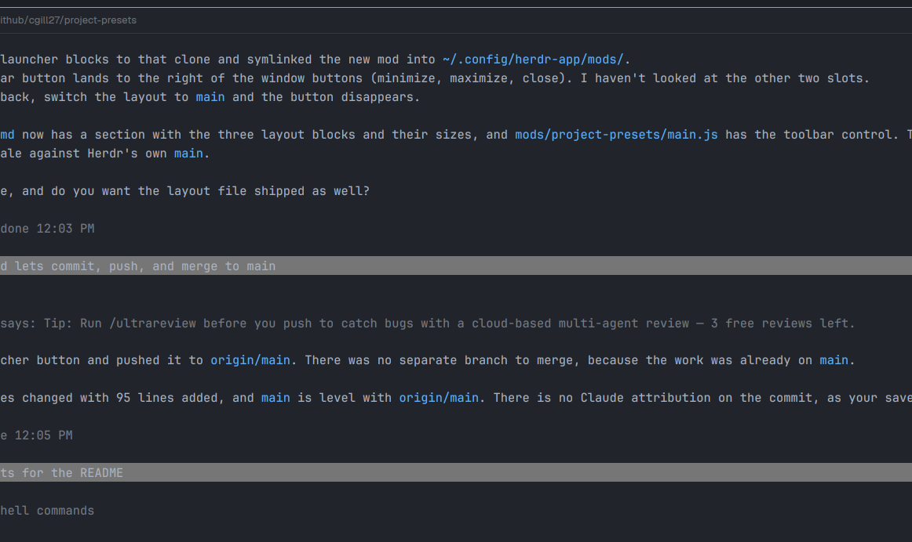

| Search by name (`apgw`) | Search by group (`pers`) |
|---|---|
| 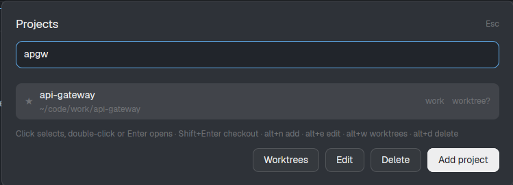 | 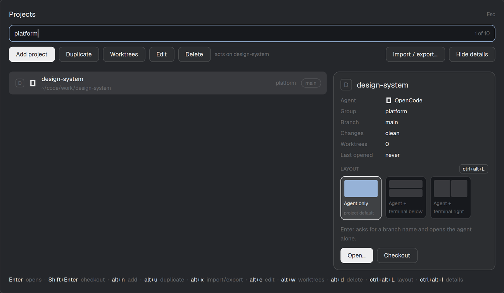 |

### Removing a project

Delete asks once, then removes the project from the list. Its folder and worktrees stay.

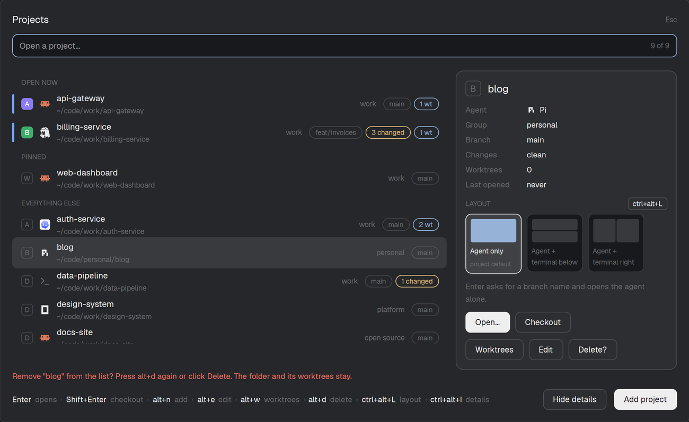

### Opening a project

A project in `ask` mode asks for a name and shows the branch it will create before you press Enter. While it works the popup lists each step, then closes.

| Branch name | Starting |
|---|---|
| 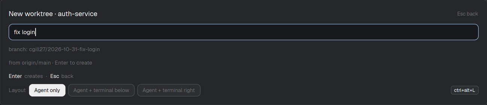 | 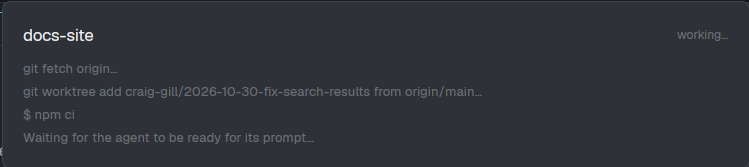 |

When it finishes you land in a new space on the new worktree, with the agent already running and your prompt sent. The space is named after the project and branch, and the sidebar nests it under the repository.

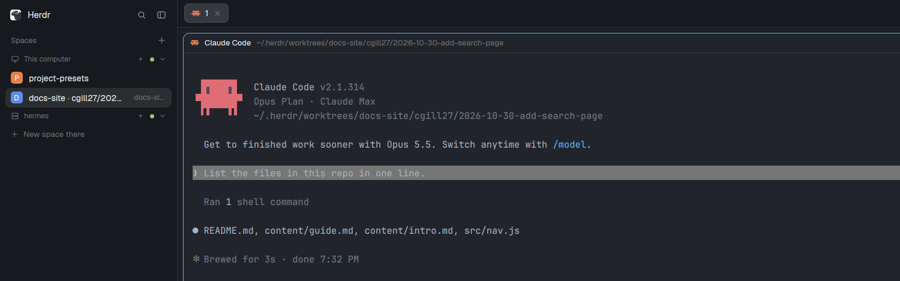

### Sections and the detail card

The list is split into **Open now**, **Pinned** and **Everything else** (no headers while you search, or when only one group has projects). Each row starts with an avatar drawn like herdr's sidebar draws a space: a tile in the space's own color with the project's initial (an outline for a project with no open space). Then come the agent icon and, once git has answered, its branch, a `N changed` chip when files are modified, and `N wt` for linked worktrees. An open space gets a status stripe on the left edge, and the marker pulses while its agent is working. Typing highlights the letters that matched, and the search box counts matches (`3 of 12`).

**The detail card is off by default.** Press **ctrl+alt+I** (**⌘⌥I** on macOS) or click Show details to turn it on; the choice is remembered. Beside the list it describes the highlighted project: agent, branch, changes, worktrees, when you last opened it, and the layout choices as small pictures of their panes. It says what Enter will do ("Enter asks for a branch name and opens agent + terminal below"). Herdr cuts a popup off when drawing it takes too long ("This view could not be re-rendered"), and the card is the most expensive part, so it stays off until you ask for it. With it off, the layout choice sits under the list as text chips (change it with **ctrl+alt+L**) and Worktrees, Edit and Delete are buttons under the list. The popup is 900 px wide; widen `overlay.width` in `mod.json` if you use the card a lot.

| The card turned on, with a layout picked for this launch | The default: the card off |
|---|---|
| 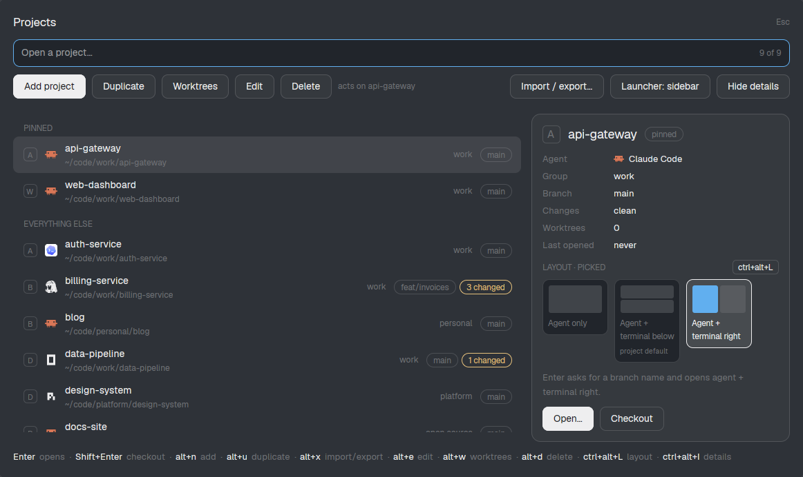 | 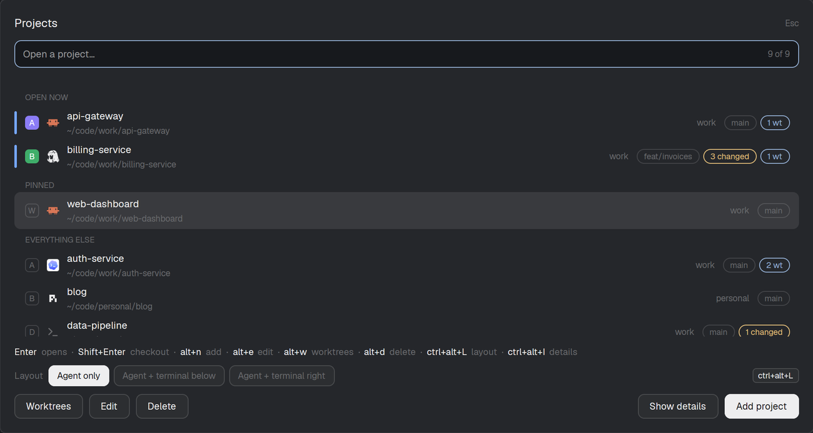 |

### Pane layouts

A project can open its space with more than the agent: a terminal below it, a file manager beside it, a log tail. Name a layout in the project's **Startup → Pane layout** field, or press **ctrl+alt+L** (**⌘⌥L** on macOS) in the list or the branch-name step to pick one for this launch: it steps through none (the agent alone) and then every layout. A selector under the projects shows them all with the one this launch will use lit, and it briefly turns bold with an accent ring after each change.

Two layouts ship: `agent-terminal` (a shell below the agent) and `agent-side-terminal` (a shell to its right). Add your own, or replace one of those, with a `layouts` list in `~/.config/herdr-app/data/project-presets.json`, next to `projects`:

```json
{
  "layouts": [
    {
      "name": "coding",
      "label": "Agent, files and a terminal",
      "panes": [
        { "type": "agent" },
        { "name": "files", "type": "command", "command": "yazi .", "direction": "right" },
        { "name": "term", "type": "shell", "direction": "down", "from": "agent" }
      ]
    }
  ],
  "projects": []
}
```

The first pane is always the agent. Every other pane needs a `direction` (`right` or `down`) and splits the previous pane, or the pane named in `from`. `type` is `shell` (your shell), `command` (runs `command`) or `agent`. All panes start in the project's folder, or the new worktree. Herdr splits evenly; sizes can't be set. A bad layout is reported before anything is created, and if a split fails the space still opens with the panes made so far. Saving a project from the editor keeps your `layouts`.

### Keeping the sidebar tidy

Herdr nests a worktree's space under its repository's own space, but only while the repo's space is open. Two settings in a project's **Worktree** section control how that looks:

- **Open the repo's space first:** when you open a worktree and the project's main checkout isn't open as a space, the mod opens it first (a plain shell, no agent). The new worktree space then nests under it, so each project is one row with its worktrees beneath it. Off by default.
- **Space name:** a template for the worktree space's name. The default `{name} · {branch}` gives `Docs Site · cgill27/2026-10-30-add-search-page`; once nested, `{slug}` (just `add-search-page`) or `{branch}` is shorter and easier to read. You can use `{name}`, `{branch}`, `{slug}`, `{user}`, `{date}` and `{repo}`.

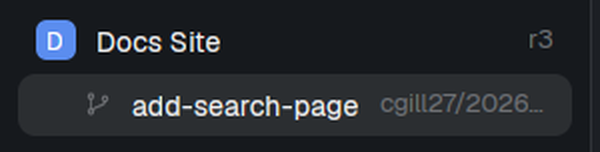

### Adding and editing a project

Settings are split into four sections.

| Project | Worktree |
|---|---|
| 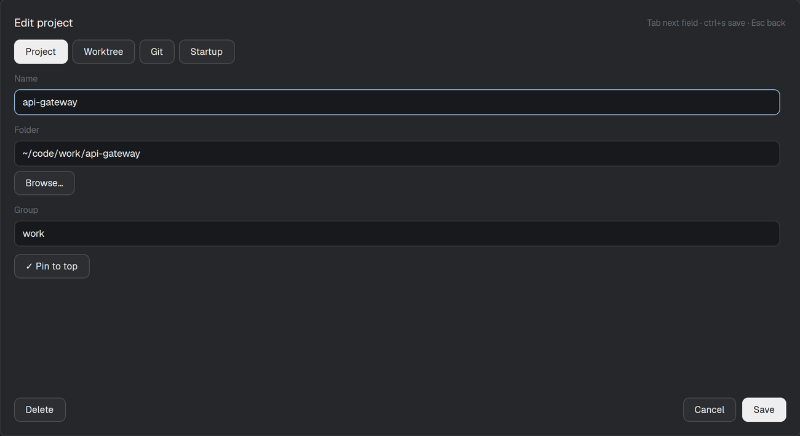 | 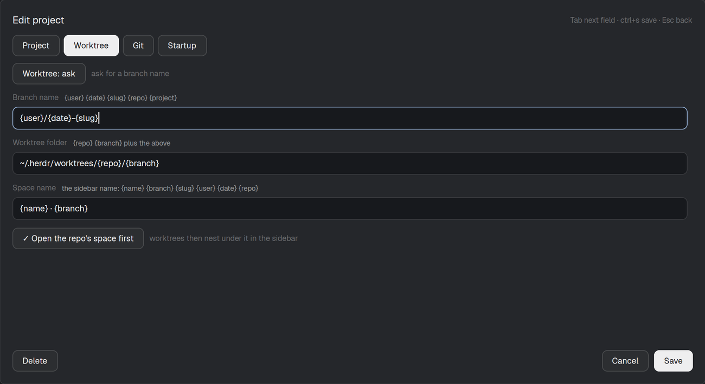 |
| **Git** | **Startup** |
| 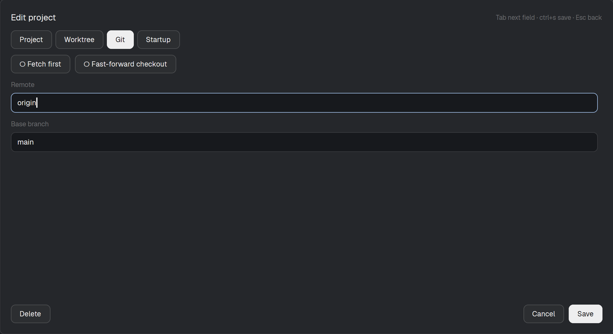 | 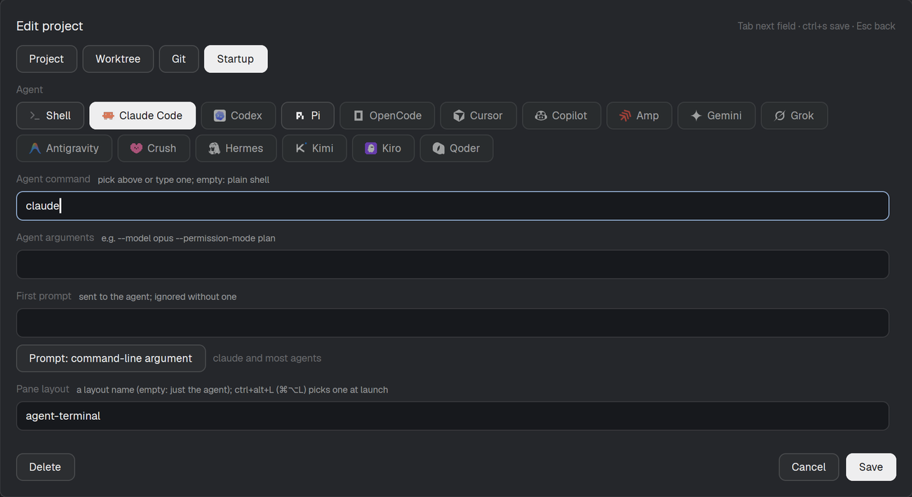 |

**Add project** opens the same editor with empty fields; Browse… picks the folder.

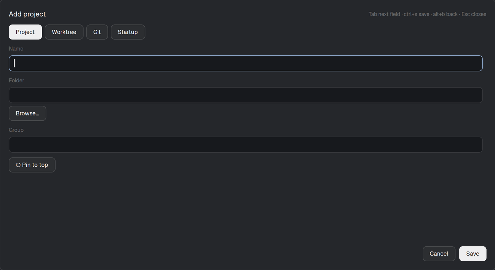

### Cleaning up worktrees

Worktrees lists a project's linked worktrees with whether each is merged into the base branch, has uncommitted changes, or is open in a space. Tick the ones to remove, or Tick merged for every merged, clean one. Removing asks once more. Worktrees with uncommitted changes are never removed, and a branch is deleted only when it is merged.

| List | Merged ticked | Confirm |
|---|---|---|
| 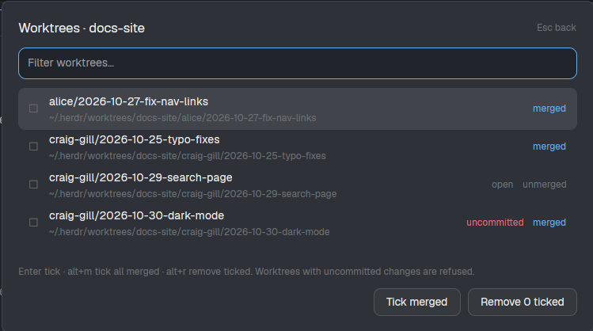 | 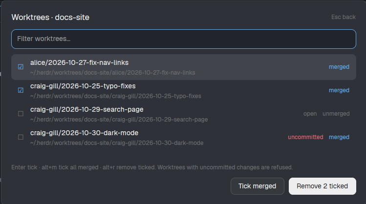 | 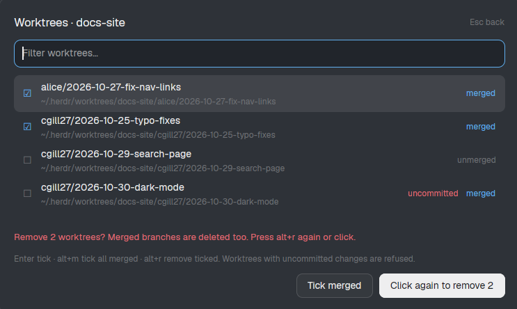 |

## Install

Copy `mods/project-presets/` to `~/.config/herdr-app/mods/` and merge `keys.json` into `~/.config/herdr-app/keys.json`. It binds `ctrl-alt-p` for Linux and Windows and `cmd-alt-p` for macOS (`cmd-p` is herdr's built-in space picker); change either to any key you like, since the key lives in your own `keys.json`, not in the mod. Inside the picker the shortcuts (add, edit, worktrees, delete) take alt, ctrl or cmd, and every one has a button too. Or ask your agent to install it from this repo; `RECIPE.md` describes the whole mod.

Projects live in `~/.config/herdr-app/data/project-presets.json`; add them with the Add project button.

## Updating

Herdr doesn't update community mods for you, so how you update depends on how you installed. Your projects live in `~/.config/herdr-app/data/project-presets.json`, outside the mod folder, so an update never touches them.

**Installed as a symlink to a clone (easiest).** Install it this way once:

```sh
git clone https://github.com/cgill27/project-presets.git ~/code/project-presets
ln -s ~/code/project-presets/mods/project-presets ~/.config/herdr-app/mods/project-presets
```

Then update with a pull. Herdr reloads a mod as soon as its files change, so there is nothing to restart:

```sh
git -C ~/code/project-presets pull --ff-only
```

**Installed by copying the folder.** Get the new version (a clone you have pulled, or the zip from the [latest release](https://github.com/cgill27/project-presets/releases/latest)) and replace the installed folder, keeping the `.d.ts` files herdr generates there:

```sh
rsync -a --delete --exclude='*.d.ts' ~/code/project-presets/mods/project-presets/ ~/.config/herdr-app/mods/project-presets/
```

**Check the release notes.** The key bindings in `keys.json` are merged into your own `~/.config/herdr-app/keys.json`, so an update never changes them. When a release changes a key, the notes say so; edit your file by hand.

## Troubleshooting

Only errors are logged by default. Debug logging is **off** unless you turn it on.

**Where the log is:** `~/.config/herdr-app/data/project-presets.log` (the last 64 KB are kept). Errors also appear in the popup.

**Turn debug logging on** to capture a problem:

1. Create the flag file:

   ```sh
   touch ~/.config/herdr-app/data/project-presets.debug
   ```

2. Close and reopen the picker (`ctrl-alt-p`). The flag is read each time the picker opens, so no restart is needed.
3. Reproduce the problem. With debug on, the log records every key, click, git command (with exit code and the first line of any error), and the steps of sending a prompt to an agent.
4. Attach the relevant lines of the log to your issue. Remove private paths or names you don't want to share first.

**Turn it off again:**

```sh
rm ~/.config/herdr-app/data/project-presets.debug
```

To start a fresh log before reproducing, empty it with `: > ~/.config/herdr-app/data/project-presets.log`.

## Development

`node --test test/` runs the tests (helpers, git, config, log and the picker's view, against real temporary git repos and stand-ins for `herdr` and gpui; how things look still needs a check by eye); `herdr-app check mods/project-presets` checks the mod. The `.d.ts` files in the mod folder are copied from `~/.config/herdr-app/` and not committed.

See [CONTRIBUTING.md](CONTRIBUTING.md) to contribute.

Setup commands and extra tabs run shell commands from your config, so read a shared config before using it.
