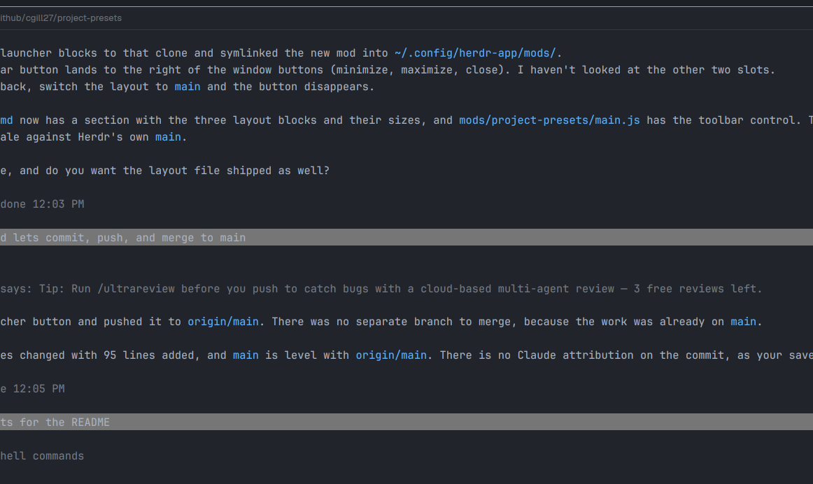

# Project presets

A project picker for the Herdr app. You keep a list of local git checkouts, each with its own settings: whether selecting it opens the checkout or a fresh worktree, how the branch is named, what git does first, and what starts in the new space. `ctrl-alt-p` opens a fuzzy-searchable list; Enter does what that project is set up to do.



## What you see

A popup, 680px wide, top-aligned 40px down, up to 80% of the window high, on the theme's `popover` background.

- Title "Projects" with "Esc" on the right.
- A 36px search box with an `accent` border.
- One 48px row per project: a marker (`●` in the agent-status color when the project's folder already has a space, `★` when pinned, else `·`), the name, the folder shortened with `~`, the group at the right, then `checkout`, `worktree?` or `worktree` for the project's mode.
- A footer line of the keys.

Ordering with an empty search: projects with an open space, pinned ones, recently used, then by name. With a query: best fuzzy match first (subsequence match on name, group and folder name; consecutive and word-start letters score higher).

The editor replaces the list in the same popup: Name, Folder (+ Browse…), Group, Pin; Worktree mode (button cycling ask / always / never), Branch name, Worktree folder; Fetch first, Fast-forward checkout, Remote, Base branch; Agent (a button per installed agent from `knownAgents()`, plus Shell), Agent command, Agent arguments, First prompt, Setup commands, Extra tabs. Buttons: Delete (asks for a second click), Cancel, Save.

## How it behaves

- **Enter** on a project follows its mode.
  - `never`: focus the project's space if its folder already has one, otherwise fetch (if on), fast-forward (if on and safe), run setup, open a space on the checkout.
  - `always`: create a worktree and open a space on it. The `{slug}` part is the time (HHMMSS).
  - `ask`: a name step appears with a live preview of the resulting branch; Enter creates it. Empty name uses the time.
- **Shift+Enter** always means the main checkout, whatever the mode.
- **alt+w** (or Worktrees) opens worktree cleanup, **alt+d** (or Delete) removes the project from the list after a second press, **alt+n** (or the Add project button) adds a project, **alt+e** (or Edit) edits the highlighted one, **ctrl+s** saves, **Tab** moves between fields, **Esc** goes back one step, then closes.
- While working, the popup lists progress lines (`git fetch origin…`, `git worktree add …`, `$ <setup command>`). An error stays on screen until Esc.
- Worktree creation: `git fetch <remote>` (a failure is logged and the local ref is used), then `git worktree add --no-track -b <branch> <folder> <remote>/<base>`. A taken branch or folder gets `-2`, `-3`… up to `-20`.
- Fast-forward only happens on the checkout when it is on the base branch, clean, and can fast-forward.
- **Worktree cleanup** lists the repo's linked worktrees (`git worktree list --porcelain`, main checkout excluded) with the branch, folder, and badges: `open` (a space shows it), `uncommitted`, `locked`, `merged` (branch is an ancestor of `<remote>/<base>`) or `unmerged`. Enter ticks the highlighted row, alt+m ticks every merged, clean one, alt+r asks for confirmation and the second press removes the ticked ones with `git worktree remove` (never `--force`, so dirty ones are refused and reported). A merged branch is then deleted with `git branch -d`; an unmerged one is kept. The space showing a removed worktree is closed with `space.close`.
- **Delete** only removes the project from `project-presets.json`; its folder and worktrees are left alone.
- Selecting a project records it in shared state `project-presets.recent` for ordering.

## Built from

- `mods/project-presets/`: `main.js` (the View: list, name step, busy, editor modes), `git.js`, `config.js`, `lib.js` (pure helpers), `mod.json` (`place: "none"`, popup overlay 680 x 0.8, `at: "top"`, `offset: 40`).
- `keys.json`: `"global": { "ctrl-alt-p": "mod.open:project-presets" }`, merged into the person's file.
- Config file `~/.config/herdr-app/data/project-presets.json` (hand-editable, written with `writeTextFile` and its expected previous text):

```json
{ "projects": [{
  "name": "API", "path": "~/code/api", "group": "work", "pinned": true,
  "worktree": { "mode": "ask|always|never", "branchTemplate": "{user}/{date}-{slug}",
                "root": "~/.herdr/worktrees/{repo}/{branch}" },
  "git": { "fetch": true, "remote": "origin", "base": "main", "fastForward": false },
  "startup": { "agent": "claude", "args": "--model opus", "prompt": "", "setup": ["npm ci"], "tabs": ["lazygit"] }
}] }
```

- Template variables: `{user}` (slug of `git config user.name`, else the local part of `user.email`, else `user`), `{date}` (YYYY-MM-DD), `{slug}` (slug of the typed name, else HHMMSS), `{repo}` (checkout folder name), `{project}` (slug of the name), `{branch}` (folder template only).
- `herdr` functions: `knownAgents`, `exec`, `run`, `focused`, `spaces`, `home`, `appHome`, `readTextFile`, `writeTextFile`, `pickFolder`, `props`, `theme`, `shared`, `setShared`, `closeOverlay`.
- Commands: `space.new {name, folder, argv, task}`, `space.select {id}`, `tab.new {space, name, folder, argv}`.
- Programs run: `git`, `test`, and `sh -c` for setup commands and extra tabs.
- Widgets from `gpui-base`: `InputState`, `Input`.

## Watch out

- Setup commands and extra tabs run arbitrary shell from the config file. Tell the person before installing a shared config.
- `exec` stops after 30 seconds, so a slow `git fetch` or setup command is cut off; the picker logs it and carries on.
- A failed setup command stops the remaining ones but the space still opens.
- The first prompt goes to the agent as a command-line argument (`space.new {task}`) by default, which `hermes` and some other agents reject as an unknown subcommand. The Prompt button switches the project to "typed after start": the agent is started bare and the prompt is sent with `hc send` once `hc ls --json` shows it idle (6 s after start if it never reports a status, never while blocked). Picking the Hermes agent button sets this automatically.
- The agent command and its arguments are split into words, with '…' and "…" keeping spaces together; there's no other shell syntax. The first prompt is only sent when an agent is set.
- Extra tabs rely on the new space being the focused one right after `space.new`.
- Local folders only: no `machine` field yet.
- The list doesn't scroll the highlight into view when there are more rows than fit.
- Shift+Enter relies on the search box passing Enter's key event through; plain Enter works either way.

## Done when

- `herdr-app check mods/project-presets` passes.
- `ctrl-alt-p` opens the picker; typing `dmo` ranks a project named Demo first.
- Adding a project with Add project and Browse… writes it to `data/project-presets.json`; a folder that isn't a git checkout is refused with a message.
- With mode `ask`, typing "fix login" shows `<user>/<date>-fix-login` and Enter creates that worktree under the configured root, from `<remote>/<base>`, in a new space.
- Selecting the same project again with `always` gives `…-2`, not an error.
- Worktrees → alt+m → alt+r twice removes merged, clean worktrees and their branches, closes their spaces, and refuses one with uncommitted changes.
- Delete asks once, then removes the project from the file.
- With mode `never`, Enter focuses an already-open space instead of making another.
